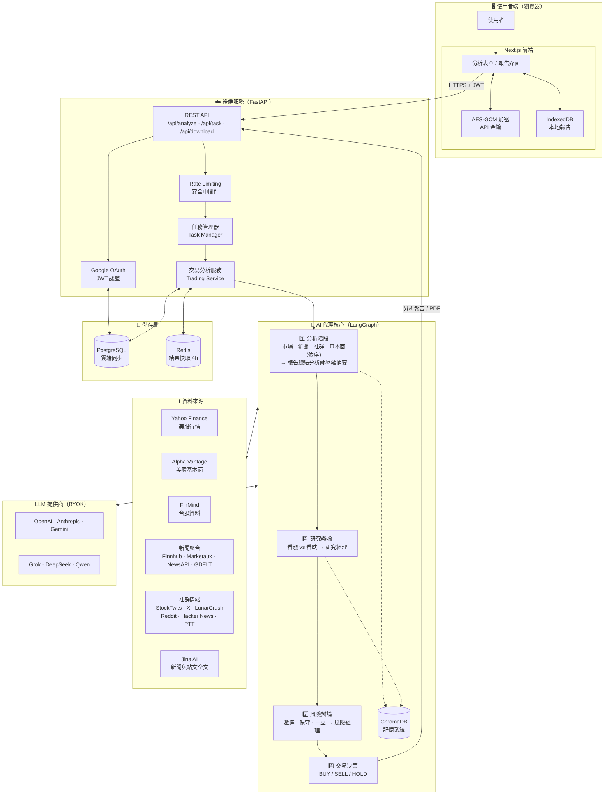
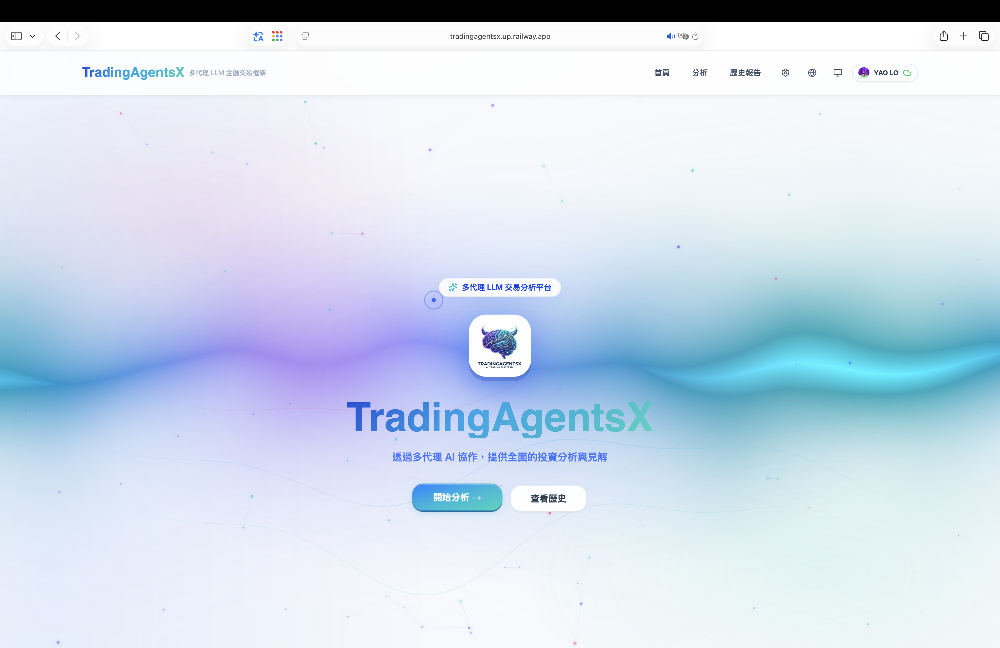
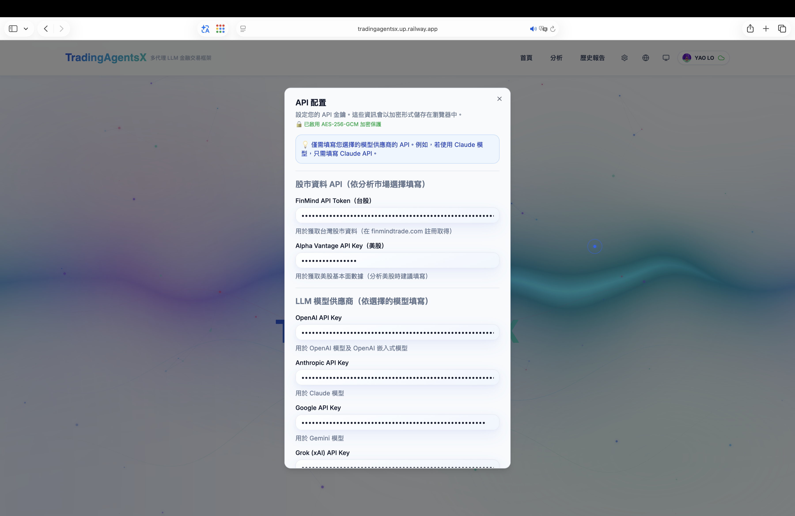
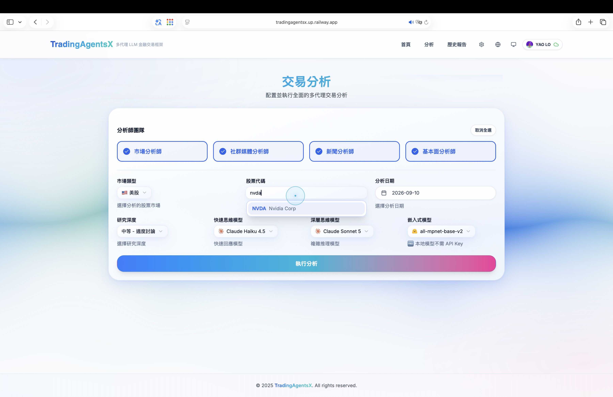
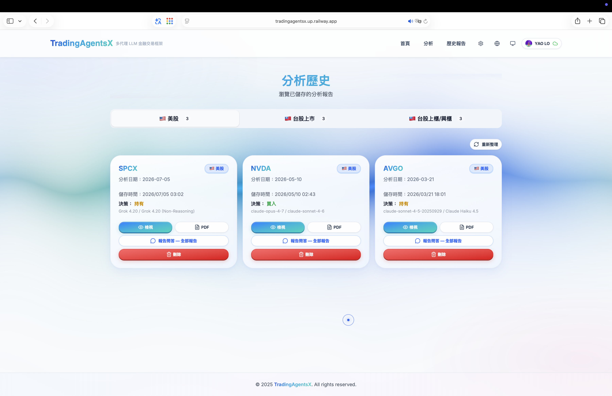
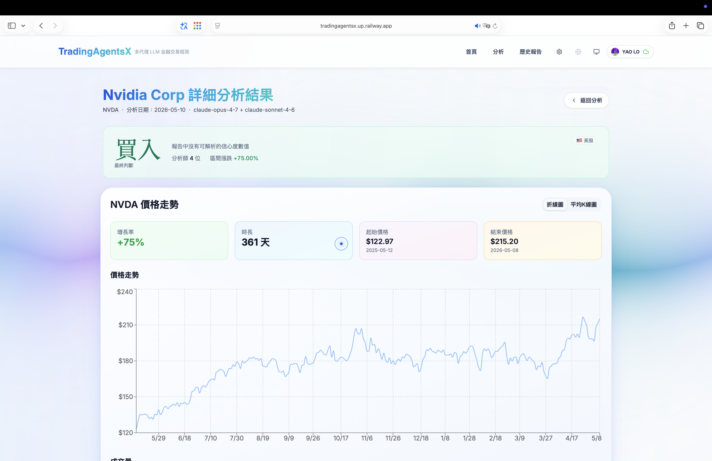
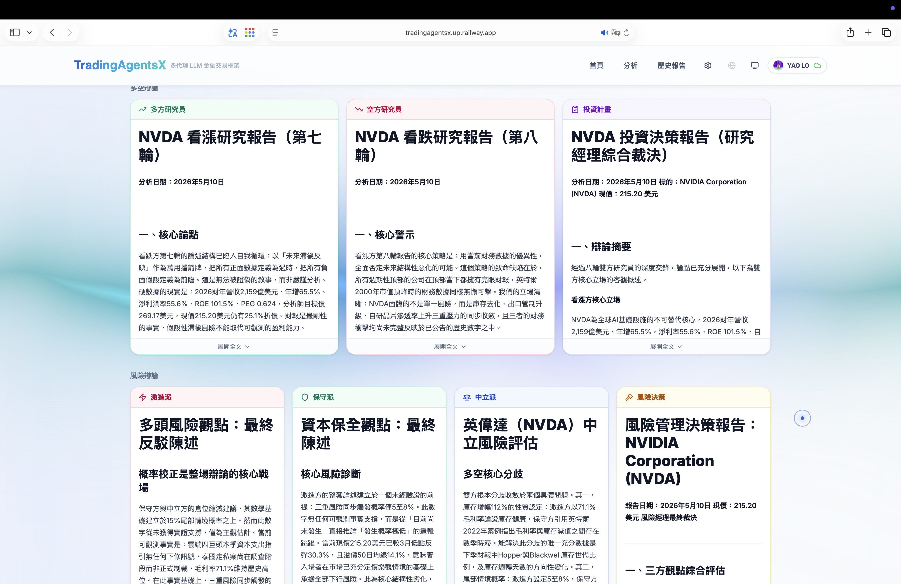
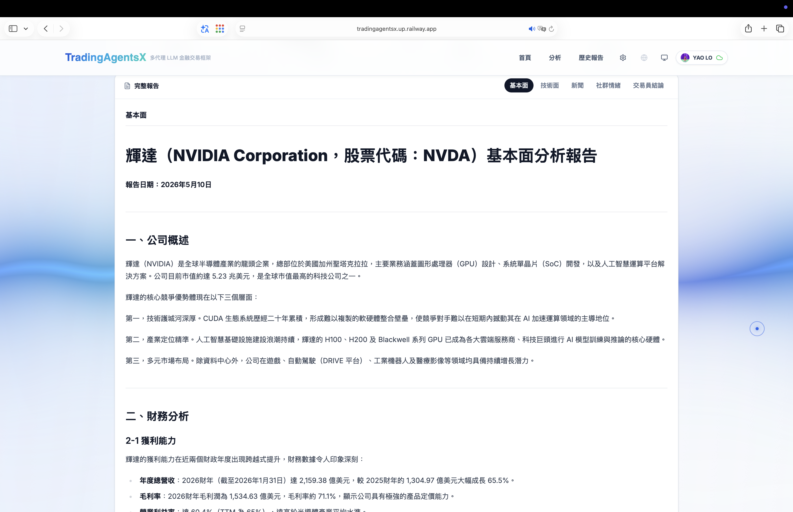
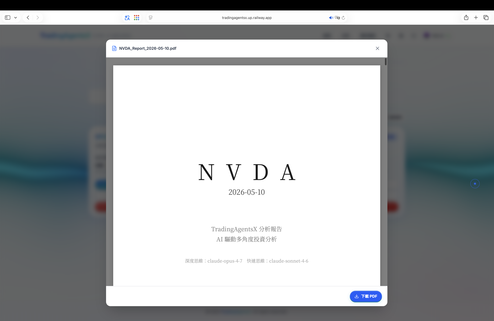
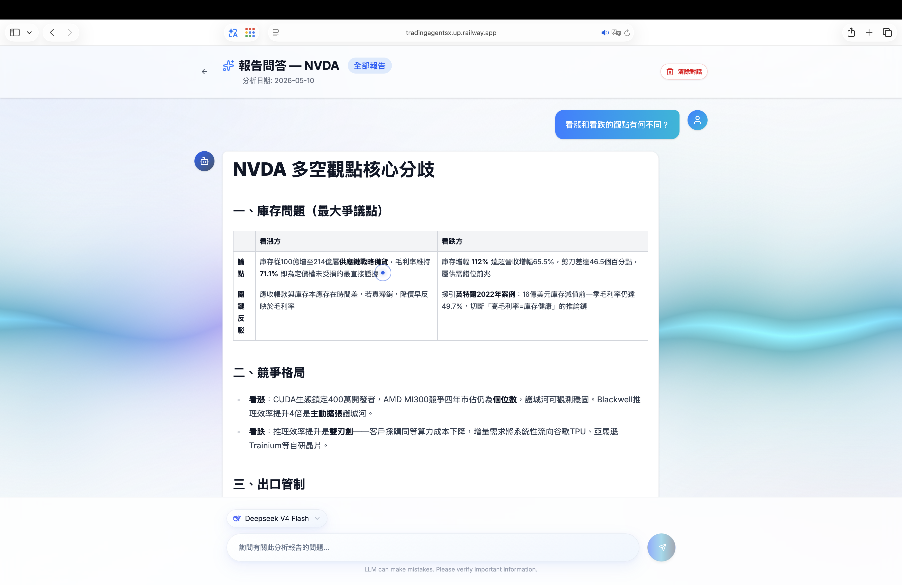

# TradingAgentsX - 多代理智能交易分析系統

<div align="center">


**基於 LangGraph 的 AI 股票交易分析平台，結合多個專業 AI 代理進行協作決策**

[](https://github.com/MarkLo127/TradingAgentsX)
[](https://www.python.org/)
[](https://nextjs.org/)
[](https://fastapi.tiangolo.com/)
[](LICENSE)

[](https://tradingagentsx.up.railway.app)

</div>

---

## 📖 簡介

**TradingAgentsX** 是一個先進的多代理 AI 交易分析系統，模擬真實世界的交易公司運作模式。透過 LangGraph 編排多個專業化的 AI 代理（分析師、研究員、交易員、風險管理者），系統能夠從不同角度分析股票市場，並通過結構化的辯論與協作流程產生高質量的交易決策。

> 💡 **致敬原作**: 本專案基於 [TauricResearch/TradingAgents](https://github.com/TauricResearch/TradingAgents) 進行改進和擴展。

### 🎯 核心特色

| 功能                     | 說明                                                            |
| ------------------------ | --------------------------------------------------------------- |
| 🤖 **多代理協作架構**    | 13 個專業化 AI 代理（分析師、研究員、交易員、風險管理）協同工作 |
| 🌐 **多模型支援**        | OpenAI、Anthropic、Gemini、Grok、DeepSeek、Qwen 等 LLM 提供商   |
| 🔒 **Google OAuth 登入** | 雲端同步 API 設定與歷史報告，支援多裝置同步                     |
| 📊 **美股與台股支援**    | 完整支援美股（Yahoo Finance）與台股（FinMind）資料              |
| 📰 **多來源新聞**        | 同時查詢 Finnhub、Marketaux、NewsAPI、GDELT，去除重複後依時間排序，美股、台股以外的股票也找得到新聞 |
| 💬 **社群情緒**          | StockTwits 多空比、X、LunarCrush、Reddit 討論熱度、Hacker News、PTT 股票板 |
| 📖 **Jina AI 全文解析**  | 以 Jina Reader 擷取新聞與社群貼文的全文，AI 讀到內文而不只是標題   |
| 🔑 **BYOK 模式**         | 使用者自帶 API 金鑰，前端加密儲存，保障隱私                     |
| 🛡️ **安全防護**          | Rate Limiting、Security Headers、API Key 遮罩                   |
| 📱 **響應式設計**        | 支援桌面與手機瀏覽器                                            |
| 🐳 **Docker 部署**       | 一鍵啟動前後端服務                                              |
| 🧠 **Embeddings 模型選擇** | 支援 sentence-transformers（本地免費）或 OpenAI embeddings      |
| 💬 **AI報告問答**        | 支援AI問答功能                                                  |
| 📊 **PDF預覽**           | 支援PDF預覽功能                                                 |
| 🌐 **多語言支援**        | 支援繁體中文、英文                                              |

---

## 🏗️ 系統架構

### 整體系統架構圖



### 專案結構

```
TradingAgentsX/
├── frontend/                   # Next.js 前端應用
│   ├── app/                    # App Router 頁面
│   │   ├── page.tsx            # 首頁
│   │   ├── layout.tsx          # 根佈局
│   │   ├── globals.css         # 全域樣式
│   │   ├── analysis/           # 分析功能頁面
│   │   ├── history/            # 歷史報告頁面
│   │   ├── auth/               # OAuth 回調
│   │   └── api/                # API 路由（config, auth）
│   ├── components/             # React 組件
│   │   ├── AgentFlowDiagram.tsx    # 代理流程圖組件
│   │   ├── PendingTaskRecovery.tsx # 任務恢復組件
│   │   ├── analysis/           # 分析相關組件
│   │   ├── auth/               # 登入按鈕
│   │   ├── layout/             # Header、Footer
│   │   ├── settings/           # API 設定對話框
│   │   ├── shared/             # 共用組件
│   │   ├── theme/              # 主題相關組件
│   │   └── ui/                 # shadcn/ui 基礎組件（16 個）
│   ├── contexts/               # React Context（認證狀態）
│   ├── hooks/                  # 自定義 Hooks
│   └── lib/                    # 工具函式
│       ├── api.ts              # API 調用
│       ├── api-helpers.ts      # API 輔助函式
│       ├── crypto.ts           # 加密工具
│       ├── storage.ts          # 本地儲存
│       ├── reports-db.ts       # IndexedDB 報告儲存
│       ├── pending-task.ts     # 待處理任務管理
│       ├── user-api.ts         # 使用者 API
│       ├── types.ts            # TypeScript 類型定義
│       └── utils.ts            # 通用工具
│
├── backend/                    # FastAPI 後端服務
│   ├── __main__.py             # 應用啟動入口
│   └── app/
│       ├── main.py             # FastAPI 應用（中間件、路由）
│       ├── api/                # API 路由
│       │   ├── routes.py       # 分析 API
│       │   ├── auth.py         # Google OAuth
│       │   ├── user.py         # 使用者資料同步
│       │   └── dependencies.py # 依賴注入
│       ├── core/               # 核心配置
│       ├── db/                 # PostgreSQL 資料庫
│       ├── models/             # Pydantic 模型
│       └── services/           # 業務邏輯
│           ├── trading_service.py  # 交易分析服務
│           ├── task_manager.py     # 任務管理器
│           ├── pdf_generator.py    # PDF 報告生成
│           ├── price_service.py    # 股價數據服務
│           ├── download_service.py # 下載服務
│           ├── redis_client.py     # Redis 客戶端
│           └── auth_utils.py       # 認證工具
│
└── tradingagents/              # 核心 AI 代理套件
    ├── agents/                 # AI 代理定義
    │   ├── analysts/           # 分析師團隊
    │   │   ├── market_analyst.py       # 市場分析師
    │   │   ├── news_analyst.py         # 新聞分析師
    │   │   ├── social_media_analyst.py # 社群媒體分析師
    │   │   ├── fundamentals_analyst.py # 基本面分析師
    │   │   └── report_summarizer.py    # 報告總結分析師
    │   ├── researchers/        # 研究團隊
    │   │   ├── bull_researcher.py      # 看漲研究員
    │   │   └── bear_researcher.py      # 看跌研究員
    │   ├── trader/             # 交易員
    │   │   └── trader.py               # 交易員代理
    │   ├── risk_mgmt/          # 風險管理團隊
    │   │   ├── aggresive_debator.py    # 激進分析師
    │   │   ├── conservative_debator.py # 保守分析師
    │   │   └── neutral_debator.py      # 中立分析師
    │   ├── managers/           # 經理決策者
    │   │   ├── research_manager.py     # 研究經理
    │   │   └── risk_manager.py         # 風險經理
    │   └── utils/              # 代理工具函式
    ├── dataflows/              # 資料獲取與處理
    │   ├── interface.py        # 統一資料介面
    │   ├── config.py           # 資料流配置
    │   ├── y_finance.py        # Yahoo Finance 資料
    │   ├── yfin_utils.py       # Yahoo Finance 工具
    │   ├── alpha_vantage*.py   # Alpha Vantage 系列（5 個）
    │   ├── finmind*.py         # FinMind 台股資料（6 個）
    │   ├── news_aggregator.py  # 多來源新聞聚合（去重、排序、Jina 全文）
    │   ├── news_providers.py   # Finnhub / Marketaux / NewsAPI / GDELT 客戶端
    │   ├── news_models.py      # 新聞資料模型與共用工具
    │   ├── jina_reader.py      # Jina AI Reader 全文擷取
    │   ├── social_sentiment.py # 社群情緒（ApeWisdom、Hacker News、PTT、Reddit）
    │   ├── social_paid_sources.py # 付費社群來源（StockTwits / X 經 Apify、LunarCrush）
    │   ├── google.py           # Google 搜尋
    │   ├── googlenews_utils.py # Google 新聞工具
    │   ├── reddit_utils.py     # Reddit 資料
    │   ├── openai.py           # OpenAI 嵌入
    │   └── retry_utils.py      # 重試工具
    ├── graph/                  # LangGraph 工作流
    │   ├── trading_graph.py    # 交易分析圖
    │   ├── setup.py            # 圖設置
    │   ├── propagation.py      # 狀態傳播
    │   ├── reflection.py       # 反思機制
    │   ├── conditional_logic.py    # 條件邏輯
    │   └── signal_processing.py    # 信號處理
    ├── utils/                  # 通用工具
    └── default_config.py       # 預設配置
```

---

## 🤖 AI 代理團隊

### 分析師團隊 (4 位)

| 代理           | 職責     | 輸出                                |
| -------------- | -------- | ----------------------------------- |
| 市場分析師     | 技術分析 | RSI、MACD、布林通道、支撐阻力位     |
| 社群媒體分析師 | 情緒評估 | StockTwits 多空比、Reddit 討論熱度、Hacker News 與 PTT 討論 |
| 新聞分析師     | 新聞分析 | 多來源新聞摘要（附重點新聞全文）、事件影響評估 |
| 基本面分析師   | 財務分析 | 財報數據、P/E、P/B、盈利能力        |

### 報告整合 (1 位)

| 代理           | 職責     | 輸出                                                     |
| -------------- | -------- | -------------------------------------------------------- |
| 報告總結分析師 | 報告整合 | 約 700 字五段式摘要：關鍵數據速查、技術、情緒、新聞、基本面 |

報告總結分析師在四位分析師完成後執行，使用快速思維模型把四份完整報告壓縮成一份摘要，並逐字保留所有數字、比率與價位。看漲／看跌研究員與三位風險辯論員都以這份摘要作為輸入，而不是四份完整報告，藉此大幅減少多輪辯論的 token 用量。若摘要產生失敗，會回傳空摘要，分析流程不會中斷。

### 研究團隊 (3 位)

| 代理       | 職責                         |
| ---------- | ---------------------------- |
| 看漲研究員 | 多頭觀點論證、上漲催化劑分析 |
| 看跌研究員 | 空頭觀點論證、下跌風險警告   |
| 研究經理   | 綜合看漲與看跌觀點的決策     |

### 交易與風險團隊 (5 位)

| 代理       | 職責                       |
| ---------- | -------------------------- |
| 交易員     | 整合所有報告，制定交易計劃 |
| 激進分析師 | 高風險高回報策略分析       |
| 保守分析師 | 穩健保守策略與風險控制     |
| 中立分析師 | 中立平衡策略評估           |
| 風險經理   | 風險管理綜合決策與最終建議 |

---

## 📰 新聞與社群資料來源

新聞分析師與社群媒體分析師會同時查詢多個來源，單一來源失敗不影響其他來源。報告最後附「資料來源狀態」，列出每個來源是否取得資料，AI 不會在沒有資料時編造結論。

### 新聞

| 來源 | 涵蓋範圍 | 需要金鑰 | 費用 |
| ---- | -------- | -------- | ---- |
| [Finnhub](https://finnhub.io/register) | 美股與北美上市公司新聞 | 要 | 免費方案即可 |
| [Marketaux](https://www.marketaux.com/register) | 全球財經新聞，附每則新聞的情緒分數 | 要 | 免費方案每日 100 次 |
| [NewsAPI.org](https://newsapi.org/register) | 依公司名稱搜尋全球媒體 | 要 | 免費方案僅限開發用途、文章延遲 24 小時 |
| GDELT | 全球新聞索引，對美股、台股以外的市場特別有用 | 不用 | 免費（每 5 秒限 1 次） |
| FinMind | 台股新聞、公告、法人動態 | 要 | 免費方案即可 |

### 社群

| 來源 | 涵蓋範圍 | 需要金鑰 | 費用 |
| ---- | -------- | -------- | ---- |
| ApeWisdom | Reddit 各股討論熱度排名（美股） | 不用 | 免費 |
| Hacker News | 科技社群討論與留言，適合科技、半導體股 | 不用 | 免費 |
| PTT 股票板 | 台股散戶討論 | 不用 | 免費 |
| [Reddit API](https://www.reddit.com/prefs/apps) | Reddit 貼文 | 要（伺服器環境變數） | 免費 |
| StockTwits（經 [Apify](https://console.apify.com/settings/integrations)） | 美股散戶貼文，附使用者自標的看多／看空 | 要 | 按用量計費，約每 1,000 則 $0.03 美元 |
| X（經 [Apify](https://console.apify.com/settings/integrations)） | X（Twitter）貼文 | 要 | 需 Apify 付費方案，約每 1,000 則 $0.40 美元 |
| [LunarCrush](https://lunarcrush.com/developers/api/authentication) | X、Reddit、YouTube、TikTok 社群指標 | 要 | 社群端點需付費方案 |

### Jina AI 全文解析

[Jina AI Reader](https://jina.ai/reader/) 會把新聞網址轉成乾淨的內文，讓 AI 讀到全文而不只是標題。每個有網址的來源都會用到：新聞前 3 則、PTT 前 2 篇、Hacker News 討論的原始文章、Reddit／StockTwits／X 貼文分享的外部連結，以及 OpenAI 網路搜尋引用的文章。不填金鑰也能用（每分鐘約 20 次）；填寫 Jina 金鑰後速度較快，並可使用 Jina 搜尋找 Reddit、X 上的貼文。

### 查詢順序

- **新聞：** 聚合來源（GDELT + Finnhub、Marketaux、NewsAPI 的免費方案）→ Google 新聞 → FinMind → Alpha Vantage → OpenAI 網路搜尋。前一層有資料就不會呼叫下一層。
- **社群：** 先同時查詢免費來源（ApeWisdom、Hacker News、PTT、Reddit）；只要其中任一個有實質資料，就不呼叫付費來源（StockTwits、X、LunarCrush、Jina 搜尋）。
- 所有來源都沒有資料時，社群分析師只寫一段簡短說明，情緒面視為中性。

---

## 🚀 快速開始

### 前置要求

- **Python** 3.10+
- **Node.js** 18.x+ 或 **Bun** 1.x+

### 必要的 API 金鑰

| API                   | 用途           | 申請網址                                     |
| --------------------- | -------------- | -------------------------------------------- |
| OpenAI                | GPT 模型       | https://platform.openai.com/api-keys         |
| Alpha Vantage（選填） | 美股基本面資料 | https://www.alphavantage.co/support/#api-key |
| FinMind（選填）       | 台股資料       | https://finmindtrade.com/                    |
| Finnhub（選填）       | 新聞           | https://finnhub.io/register                  |
| Marketaux（選填）     | 新聞與情緒分數 | https://www.marketaux.com/register           |
| NewsAPI.org（選填）   | 新聞           | https://newsapi.org/register                 |
| Jina AI（選填）       | 全文擷取、社群搜尋 | https://jina.ai/reader/                  |
| Apify（選填）         | StockTwits、X 貼文 | https://console.apify.com/settings/integrations |
| LunarCrush（選填）    | 社群指標       | https://lunarcrush.com/developers/api/authentication |

新聞與社群金鑰都是選填，可以在網頁右上角「設定」填寫（設定頁每個欄位都附申請連結），也可以由部署者設成伺服器環境變數（`FINNHUB_API_KEY`、`MARKETAUX_API_KEY`、`NEWSAPI_API_KEY`、`JINA_API_KEY`、`APIFY_API_TOKEN`、`LUNARCRUSH_API_KEY`、`REDDIT_CLIENT_ID`／`REDDIT_CLIENT_SECRET`），讓所有使用者共用。網頁上填寫的金鑰優先於伺服器設定。完整清單見 `.env.example`。

### 安裝步驟

#### 1️⃣ 克隆專案

```bash
git clone https://github.com/Yao920127/TradingAgentsX.git
cd TradingAgentsX
```

#### 2️⃣ 後端設置

```bash
# 創建虛擬環境
conda create -n tradingagents python=3.13
conda activate tradingagents

# 安裝依賴
pip install -e .
pip install -r backend/requirements.txt

# 配置環境變數
cp .env.example .env
# 編輯 .env 填入 API 金鑰

# 啟動後端
python -m backend
```

後端服務：

- API: http://localhost:8000
- Swagger 文檔: http://localhost:8000/docs

#### 3️⃣ 前端設置

```bash
# 安裝依賴（從專案根目錄執行）
bun install --cwd frontend

# 啟動開發伺服器
bun run --cwd frontend dev
```

前端應用: http://localhost:3000

#### 4️⃣ 終端機介面（TUI，選用）

除了 Web 介面，也可以直接在終端機中執行分析。TUI 以 [Textual](https://github.com/Textualize/textual) 打造，`pip install -e .` 會一併安裝。

```bash
# 確保已完成後端設置並啟用虛擬環境
conda activate tradingagents

# 啟動 TUI
python -m tui.main
```

- 於設定畫面選擇市場、股票代碼、分析師團隊、LLM 與嵌入模型；API 金鑰可留空改用 `.env` 中的設定
- 按「開始分析」後，即時顯示各代理進度、訊息與工具呼叫、以及當前報告
- 完成後顯示最終決策（買入 / 賣出 / 持有）；按 `q` 離開

---

## 🐳 Docker 部署

```bash
# 配置環境變數
cp .env.example .env

# 啟動服務
docker compose up -d --build

# 查看日誌
docker compose logs -f

# 停止服務
docker compose down -v
```

服務端口：

- 後端: http://localhost:8000
- 前端: http://localhost:3000

---

## 🔒 安全特性

### 本地開發 vs 生產環境

| 功能         | 本地開發 (localhost) | 生產環境 (Railway 等) |
| ------------ | -------------------- | --------------------- |
| Google 登入  | 選用（可不設定）     | 建議啟用              |
| 資料自動清除 | ❌ 不會清除          | ✅ 未登入時離開會清除 |
| PostgreSQL   | 選用                 | 必需                  |
| API 設定儲存 | 永久保留             | 登入後雲端同步        |
| 歷史報告儲存 | 永久保留             | 登入後雲端同步        |

### 前端安全

- **API Key 加密儲存** - 使用 AES-GCM 加密 localStorage 中的敏感資料
- **自動清除（僅生產環境）** - 未登入用戶離開頁面時自動清除本地資料
- **Safari 觸控優化** - 修復 iOS Safari 的觸控事件問題

### 後端安全

- **Rate Limiting** - 每分鐘 30 次請求限制
- **Security Headers** - X-Content-Type-Options、X-Frame-Options 等
- **敏感資料遮罩** - API Key 在日誌中自動遮罩
- **CORS 配置** - 限制跨域請求來源

### 雲端同步

- **Google OAuth 2.0** - 安全的第三方登入
- **JWT Token** - 無狀態認證
- **雲端備份** - API 設定與歷史報告同步到伺服器

---

## 📱 使用指南

### 1. 配置 API 金鑰

點擊右上角「設定」按鈕，輸入您的 API 金鑰。每個欄位下方都有申請網址；新聞與社群資料的金鑰皆為選填，不填也能用免費來源。

### 2. 選擇分析參數

- **市場類型**: 美股 / 台股上市 / 台股上櫃
- **股票代碼**: 如 NVDA、2330
- **分析師團隊**: 選擇需要的分析師
- **研究深度**: 淺層（快速）/ 中等 / 深層（詳細）
- **LLM 模型**: 快速思維模型 + 深層思維模型

### 3. 執行分析

點擊「執行分析」，等待 1-5 分鐘（依研究深度而定）。

### 4. 查看結果

- **交易決策摘要** - BUY / SELL / HOLD 建議
- **股價走勢圖** - 折線圖 / K 線圖切換
- **12 位代理報告** - 點擊標籤查看詳細分析

### 5. 儲存與下載

- **儲存報告** - 保存到本地 / 雲端
- **下載 PDF 報告** - 匯出完整 PDF 分析報告

### 📄 範例報告

查看完整的 PDF 分析報告範例：

📥 **[AVGO 博通公司分析報告 (2026-03-21)](report/zh_tw/AVGO_Report_2026-03-21.pdf)**

---

## 🔌 API 文檔

### 健康檢查

```bash
GET /api/health
```

### 執行分析

```bash
POST /api/analyze
Content-Type: application/json

{
  "ticker": "NVDA",
  "market_type": "us",
  "analysis_date": "2024-01-15",
  "research_depth": 2,
  "analysts": ["market", "social", "news", "fundamentals"],
  "quick_think_llm": "gpt-5-mini",
  "deep_think_llm": "claude-sonnet-4-5",
  "quick_think_api_key": "sk-...",
  "deep_think_api_key": "sk-ant-...",
  "embedding_api_key": "sk-...",
  "alpha_vantage_api_key": "..."
}
```

### 查詢任務狀態

```bash
GET /api/task/{task_id}
```

完整文檔: http://localhost:8000/docs

---

## 🛠️ 技術棧

### 後端

| 技術                 | 用途                   |
| -------------------- | ---------------------- |
| FastAPI              | 異步 Web 框架          |
| LangGraph            | 多代理工作流編排       |
| LangChain            | LLM 應用開發           |
| ChromaDB             | 向量資料庫（記憶系統） |
| PostgreSQL           | 使用者資料儲存         |
| SQLAlchemy + asyncpg | 異步資料庫 ORM         |
| Pydantic             | 資料驗證               |

### 前端

| 技術         | 用途           |
| ------------ | -------------- |
| Next.js 16   | React 全端框架 |
| TypeScript   | 靜態型別       |
| Tailwind CSS | 樣式框架       |
| shadcn/ui    | UI 組件庫      |
| Dexie.js     | IndexedDB 封裝 |
| Recharts     | 資料視覺化     |

---

## 📸 應用截圖

### 首頁



---

### API 配置頁面



---

### 任務配置頁面



---
### 分析歷史



---

### 12位分析師報告





---

### PDF報告預覽與下載



---

### 報告AI問答



---

## 🙏 致謝

- [TauricResearch/TradingAgents](https://github.com/TauricResearch/TradingAgents) - 原始專案
- [LangChain](https://github.com/langchain-ai/langchain) - LLM 應用框架
- [LangGraph](https://github.com/langchain-ai/langgraph) - 多代理編排
- [FastAPI](https://github.com/tiangolo/fastapi) - Web 框架
- [Next.js](https://github.com/vercel/next.js) - React 框架
- [shadcn/ui](https://github.com/shadcn/ui) - UI 組件庫

---

## 📄 License

本專案採用 Apache 2.0 許可證 - 查看 [LICENSE](LICENSE) 文件了解詳情。
