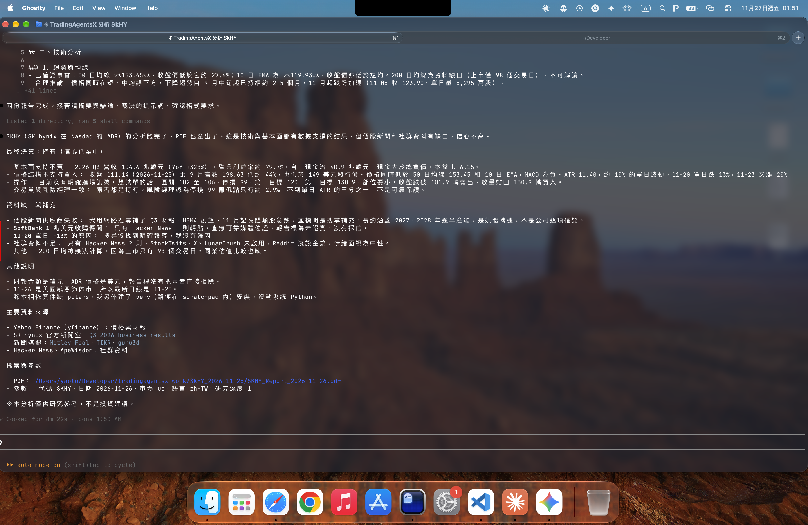
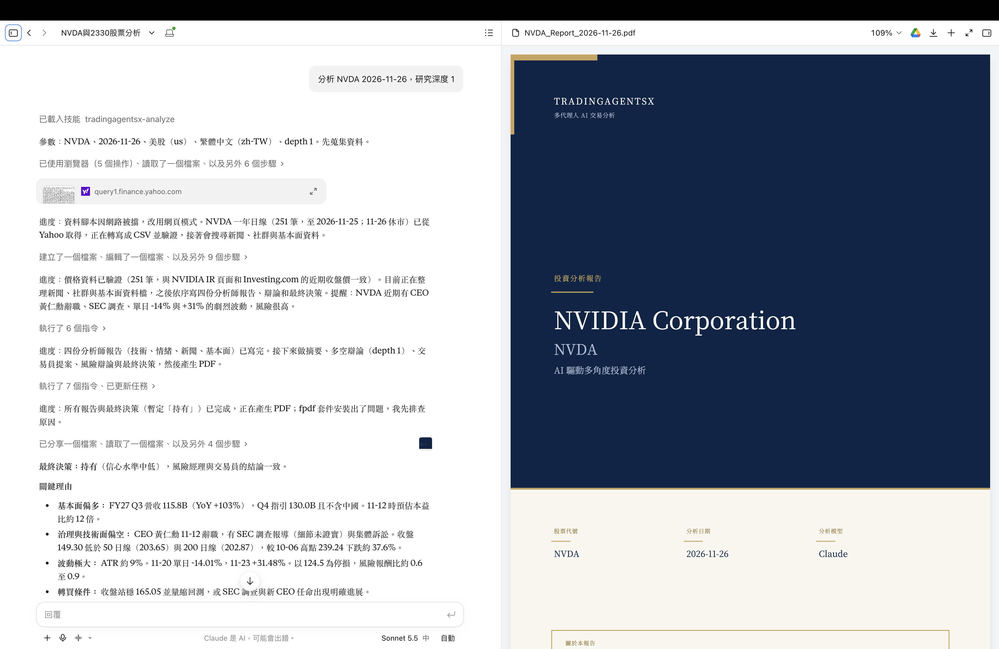

# TradingAgentsX Claude Skill

**繁體中文 | [English](README_EN.md)**　·　[回到專案首頁](../README.md)

把 12 位分析師的完整流程（資料蒐集 → 四位分析師 → 多空辯論 → 風險辯論 → 最終決策 → PDF）做成 skill，由執行的模型本身（Claude、Gemini 等）擔任，不需要任何 LLM 金鑰。輸入股票代碼與日期即可，例如「分析 NVDA 2026-11-26」或「分析 2330 2026-11-26」。

### Claude Code（plugin）

在 Claude Code 對話框中，**一次貼一行**：

1. 加入 marketplace：

```
/plugin marketplace add Yao920127/TradingAgentsX
```

2. 安裝 plugin：

```
/plugin install tradingagentsx@tradingagentsx
```

**或在一般終端機執行：**

```bash
claude plugin marketplace add Yao920127/TradingAgentsX
```

```bash
claude plugin install tradingagentsx@tradingagentsx
```

**更新到新版（不需要先刪除）**，在 Claude Code 對話框一次貼一行：

```
/plugin marketplace update tradingagentsx
```

```
/plugin update tradingagentsx@tradingagentsx
```

或在一般終端機：

```bash
claude plugin marketplace update tradingagentsx
```

```bash
claude plugin update tradingagentsx@tradingagentsx
```

更新後**重開 Claude Code** 才會載入新版，可用 `/plugin` 確認版本，或在終端機只查這個 skill：

```bash
claude plugin list | grep -A3 "tradingagentsx@tradingagentsx"
```

（`claude plugin list` 不接受 plugin 名稱當參數，後面多加名稱仍會列出全部，所以要用 `grep` 篩選。）若仍停在舊版，改成解除安裝再安裝：

```bash
claude plugin uninstall tradingagentsx@tradingagentsx
```

```bash
claude plugin install tradingagentsx@tradingagentsx
```

### 用 npx 安裝（skills CLI；Claude Code、Codex、Cursor、OpenCode 等）

需要 Node.js 22.20 以上。指令會從本倉庫的 `plugins/` 抓取已建置完成的版本（含提示詞、vendor 與繁中字型）。

**安裝**（預設裝在目前專案，執行後選擇要安裝到哪些 agent）：

```bash
npx skills add Yao920127/TradingAgentsX --skill tradingagentsx-analyze
```

全域安裝（所有專案都能用），加上 `-g`：

```bash
npx skills add Yao920127/TradingAgentsX --skill tradingagentsx-analyze -g
```

執行後會互動詢問要安裝到哪些 agent（Claude Code、Codex、Cursor、OpenCode 等），不需要事先指定。

**查看與檢查更新**：

```bash
npx skills list
```

```bash
npx skills check
```

**更新**（指定名稱；`-p` 只更新專案、`-g` 只更新全域、`-y` 跳過確認）：

```bash
npx skills update tradingagentsx-analyze
```

**刪除**（`-g` 刪全域、`-a` 限定 agent、`-y` 跳過確認）：

```bash
npx skills remove tradingagentsx-analyze
```

```bash
npx skills remove tradingagentsx-analyze -g
```

> 安裝位置：Claude Code 為 `.claude/skills/`（全域 `~/.claude/skills/`），其他 agent 多為 `.agents/skills/`。腳本模式的相依套件請對該目錄下的 `requirements.txt` 執行 `pip install -r`。

**腳本模式的相依與金鑰（選用）**

```bash
pip install -r ~/.claude/plugins/.../skills/tradingagentsx-analyze/requirements.txt
```

台股需環境變數 `FINMIND_API_TOKEN`，美股新聞可設 `FINNHUB_API_KEY` / `MARKETAUX_API_KEY` / `NEWSAPI_API_KEY`。缺少時該類資料會標示「資料缺口」，Claude 會自行搜尋補充。

### Claude app

**Claude app（下載 zip 上傳）**：[下載 tradingagentsx-analyze.zip](https://github.com/Yao920127/TradingAgentsX/releases/latest/download/tradingagentsx-analyze.zip)（約 12 MB，內含繁中字型），到 設定 → 功能 → Skills 上傳。所有版本見 [Releases](https://github.com/Yao920127/TradingAgentsX/releases)。Claude app 容器連不到資料來源，改由 Claude 用自己的網頁工具蒐集資料。

### 怎麼問

直接用自然語言，代碼與日期必填，其餘有預設值：

```
分析 NVDA 2026-11-26
分析 2330 2026-11-26，研究深度 1
分析 5274 2026-11-26（上櫃），研究深度 3
analyze NVDA on 2026-11-26, depth 2, in English
分析 NVDA 2026-11-26，只要技術面和新聞
```

| 參數 | 說明 | 預設 |
| ---- | ---- | ---- |
| 股票代碼 | 美股如 `NVDA`；台股用純數字如 `2330` | 必填 |
| 日期 | `YYYY-MM-DD`，只使用該日以前的資料 | 今天 |
| 市場 | 美股 / 台股上市（`twse`）/ 台股上櫃（`tpex`），台股數字代碼預設上市，上櫃請說明 | 自動判斷 |
| 語言 | 用繁中問就出繁中報告，用英文問就出英文報告 | 跟隨提問語言 |
| 研究深度 | 1–5，見下表 | 3 |
| 分析師 | 技術面、社群、新聞、基本面可複選，至少 1 位，和網頁版的「分析師團隊」勾選相同；沒選的不會蒐集資料與撰寫，結論也不涵蓋該面向。價格走勢圖一律會附上 | 全 4 位 |

### 可以使用哪些資料

| 資料 | Claude Code（腳本模式） | Claude app（網頁工具模式） |
| ---- | ---- | ---- |
| 美股股價 | Yahoo Finance | Claude 以內建瀏覽器讀取 Yahoo Finance |
| 台股股價 | FinMind（需 `FINMIND_API_TOKEN`） | FinMind 公開 JSON |
| 技術指標 | 本地計算：50/200 日均線、10 日 EMA、MACD、RSI、布林通道、ATR、VWMA、MFI | 同左 |
| 基本面 | 美股：Alpha Vantage 或 yfinance；台股：FinMind | 財報新聞稿、SEC 文件、FinMind |
| 新聞 | 美股：Finnhub／Marketaux／NewsAPI（自備金鑰）；台股：FinMind | Claude 網路搜尋 |
| 社群 | 免費來源：ApeWisdom、Hacker News、PTT | Claude 網路搜尋 |

任何一類資料取不到時，報告會標示「資料缺口」，Claude 會先自行搜尋補充並註明來源，補不到就明講並降低結論力道，不會編造。價格資料一定要完整日線，轉寫後會通過筆數與數值驗證才繼續。

### 研究深度

深度決定多空辯論與風險辯論的發言次數，越深越完整，也越久、用量越大。辯論一定會進行，不會跳過。

| 深度 | 多空辯論 | 風險辯論 | 獨立撰寫次數 | 適合 |
| ---- | -------- | -------- | ------------ | ---- |
| 1 | 2 次發言 | 3 次發言 | 約 19 | 快速看一眼（Claude Code 實測約 8 分鐘） |
| 2 | 4 次 | 6 次 | 約 24 | 日常使用 |
| 3（預設） | 6 次 | 9 次 | 約 29 | 完整辯論 |
| 4 | 8 次 | 12 次 | 約 34 | 重要決策前 |
| 5 | 10 次 | 15 次 | 約 39 | 最完整，耗時最久 |

> 輸出僅供研究參考，不是投資建議。

**執行畫面**

Claude Code（終端機）分析 SKHY，完成後回報最終決策、資料缺口與 PDF 路徑：



Claude app 分析 NVDA，右側直接預覽產出的 PDF 報告：



### 維護者

自行產生 zip（輸出 `dist/tradingagentsx-analyze.zip`）：

```bash
python scripts/build_skill.py
```

修改提示詞、`pdf_generator.py`、dataflows 或 `skill-src/` 後，重建 plugin 並提交 `plugins/tradingagentsx/`（測試會檢查是否同步）：

```bash
python scripts/build_skill.py --plugin
```
