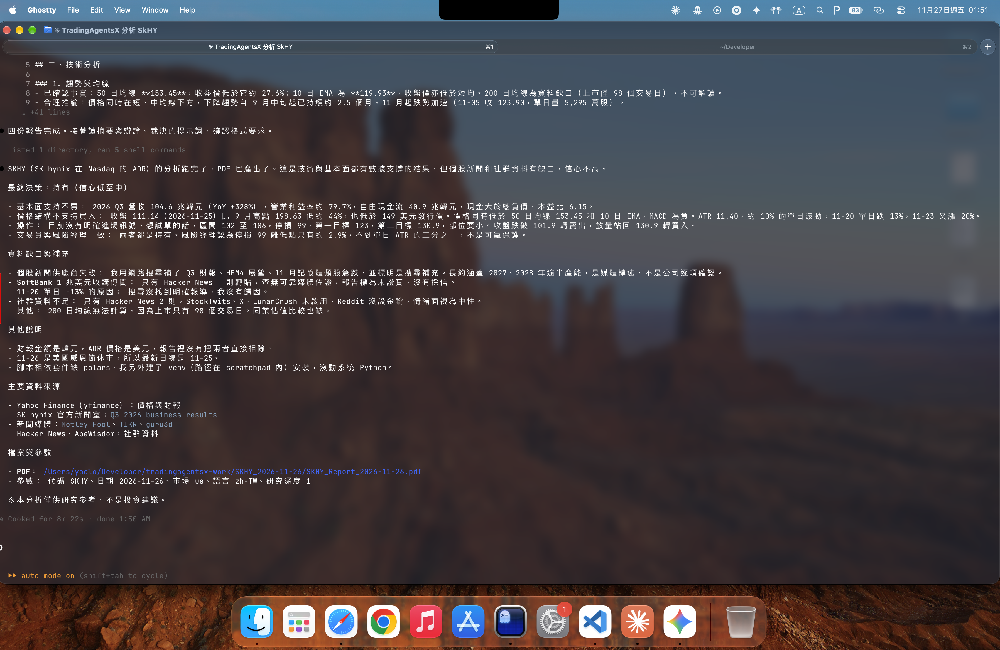
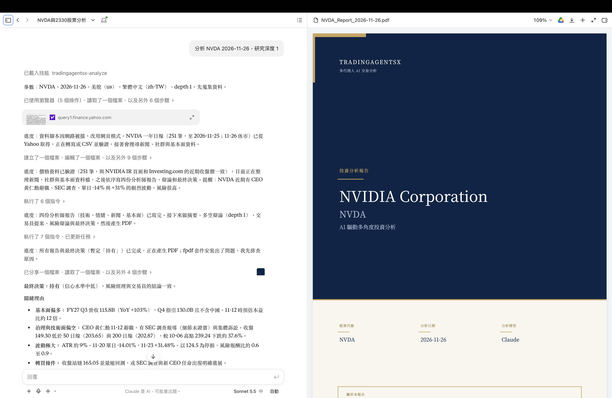

# TradingAgentsX Claude Skill

**[繁體中文](README.md) | English**　·　[Back to project home](../README_EN.md)

The full 12-agent flow (data collection → four analysts → bull/bear debate → risk debate → final decision → PDF) is packaged as a skill. the model running the skill (Claude, Gemini, etc.) acts as every agent, so no LLM API key is needed. Just give a ticker and a date, e.g. "analyze NVDA on 2026-11-26" or "analyze 2330 on 2026-11-26".

### Claude Code (plugin)

In the Claude Code prompt, paste **one line at a time**:

1. Add the marketplace:

```
/plugin marketplace add Yao920127/TradingAgentsX
```

2. Install the plugin:

```
/plugin install tradingagentsx@tradingagentsx
```

**Or from a regular terminal:**

```bash
claude plugin marketplace add Yao920127/TradingAgentsX
```

```bash
claude plugin install tradingagentsx@tradingagentsx
```

**Updating to a new version (no need to uninstall first)**, paste one line at a time in the Claude Code prompt:

```
/plugin marketplace update tradingagentsx
```

```
/plugin update tradingagentsx@tradingagentsx
```

Or from a regular terminal:

```bash
claude plugin marketplace update tradingagentsx
```

```bash
claude plugin update tradingagentsx@tradingagentsx
```

**Restart Claude Code** after updating so the new version loads, and check the version with `/plugin`, or show only this skill in the terminal:

```bash
claude plugin list | grep -A3 "tradingagentsx@tradingagentsx"
```

(`claude plugin list` takes no plugin-name argument — extra names are ignored and everything is listed, so filter with `grep`.) If it still shows the old version, uninstall and reinstall:

```bash
claude plugin uninstall tradingagentsx@tradingagentsx
```

```bash
claude plugin install tradingagentsx@tradingagentsx
```

### Install with npx (skills CLI; Claude Code, Codex, Cursor, OpenCode, …)

Requires Node.js 22.20 or newer. The command pulls the pre-built version from this repo's `plugins/` folder (with prompts, vendor and the Traditional Chinese font).

**Install** (into the current project by default; you choose which agents to install to when prompted):

```bash
npx skills add Yao920127/TradingAgentsX --skill tradingagentsx-analyze
```

Global install (available in every project), add `-g`:

```bash
npx skills add Yao920127/TradingAgentsX --skill tradingagentsx-analyze -g
```

The CLI then asks which agents to install to (Claude Code, Codex, Cursor, OpenCode, …), so you do not need to specify one.

**List and check for updates**:

```bash
npx skills list
```

```bash
npx skills check
```

**Update** (by name; `-p` project only, `-g` global only, `-y` skip confirmation):

```bash
npx skills update tradingagentsx-analyze
```

**Remove** (`-g` removes the global copy, `-a` limits to one agent, `-y` skips confirmation):

```bash
npx skills remove tradingagentsx-analyze
```

```bash
npx skills remove tradingagentsx-analyze -g
```

> Install location: `.claude/skills/` for Claude Code (global `~/.claude/skills/`), `.agents/skills/` for most other agents. For script mode, run `pip install -r` on the `requirements.txt` inside that folder.

**Optional script-mode dependencies and keys**

```bash
pip install -r ~/.claude/plugins/.../skills/tradingagentsx-analyze/requirements.txt
```

Taiwan stocks need `FINMIND_API_TOKEN`; US news can use `FINNHUB_API_KEY` / `MARKETAUX_API_KEY` / `NEWSAPI_API_KEY`. Missing data is flagged as a data gap and Claude searches the web to fill it.

### Claude app

**Claude app (download and upload the zip)**: [download tradingagentsx-analyze.zip](https://github.com/Yao920127/TradingAgentsX/releases/latest/download/tradingagentsx-analyze.zip) (about 12 MB, includes the Traditional Chinese font), then upload it under Settings → Capabilities → Skills. All versions are on the [Releases](https://github.com/Yao920127/TradingAgentsX/releases) page. The Claude app sandbox cannot reach market-data hosts, so Claude collects data with its own web tools.

### How to ask

Plain language works. Ticker and date are required; everything else has a default:

```
analyze NVDA on 2026-11-26
analyze 2330 on 2026-11-26, depth 1
analyze 5274 on 2026-11-26 (OTC), depth 3
analyze NVDA on 2026-11-26, technical and news analysts only
分析 NVDA 2026-11-26，用繁體中文
```

| Parameter | Description | Default |
| --------- | ----------- | ------- |
| Ticker | US stocks like `NVDA`; Taiwan stocks use the number, e.g. `2330` | Required |
| Date | `YYYY-MM-DD`; only data up to that date is used | Today |
| Market | US / Taiwan listed (`twse`) / Taiwan OTC (`tpex`); numeric Taiwan tickers default to listed, say so for OTC | Auto-detected |
| Language | Ask in Traditional Chinese for a Chinese report, in English for an English one | Follows your prompt |
| Research depth | 1–5, see below | 3 |
| Analysts | Any of technical, social, news and fundamentals, at least one, same as the web app's analyst team checkboxes. Unselected ones are not researched or written and the conclusion does not cover that angle. The price chart is always included | All 4 |

### What data it can use

| Data | Claude Code (script mode) | Claude app (web-tool mode) |
| ---- | ------------------------- | -------------------------- |
| US prices | Yahoo Finance | Claude reads Yahoo Finance in its built-in browser |
| Taiwan prices | FinMind (needs `FINMIND_API_TOKEN`) | FinMind public JSON |
| Technical indicators | Computed locally: 50/200-day SMA, 10-day EMA, MACD, RSI, Bollinger Bands, ATR, VWMA, MFI | Same |
| Fundamentals | US: Alpha Vantage or yfinance; Taiwan: FinMind | Earnings releases, SEC filings, FinMind |
| News | US: Finnhub / Marketaux / NewsAPI (your own keys); Taiwan: FinMind | Claude web search |
| Social | Free sources: ApeWisdom, Hacker News, PTT | Claude web search |

When a data type is unavailable, the report marks it as a "data gap". Claude first tries to fill it by searching the web and notes the source; if it still cannot, it says so and lowers the confidence of its conclusions, never inventing data. Prices must be full daily bars and pass row-count and value checks before the analysis continues.

### Research depth

Depth sets how many turns the bull/bear and risk debates run: deeper is more thorough, slower and uses more tokens. The debates always run; none is skipped.

| Depth | Bull/bear debate | Risk debate | Separate writing steps | Good for |
| ----- | ---------------- | ----------- | ---------------------- | -------- |
| 1 | 2 turns | 3 turns | about 19 | A quick look (about 8 minutes measured in Claude Code) |
| 2 | 4 turns | 6 turns | about 24 | Everyday use |
| 3 (default) | 6 turns | 9 turns | about 29 | Full debate |
| 4 | 8 turns | 12 turns | about 34 | Before an important decision |
| 5 | 10 turns | 15 turns | about 39 | Most thorough, slowest |

> Output is for research only and is not investment advice.

**Screenshots**

Claude Code (terminal) analyzing SKHY, reporting the final decision, data gaps and the PDF path when done:



Claude app analyzing NVDA, with the generated PDF report previewed on the right:



### Maintainers

Build the zip yourself (outputs `dist/tradingagentsx-analyze.zip`):

```bash
python scripts/build_skill.py
```

After changing prompts, `pdf_generator.py`, dataflows or `skill-src/`, rebuild the plugin and commit `plugins/tradingagentsx/` (a test checks that it is in sync):

```bash
python scripts/build_skill.py --plugin
```
